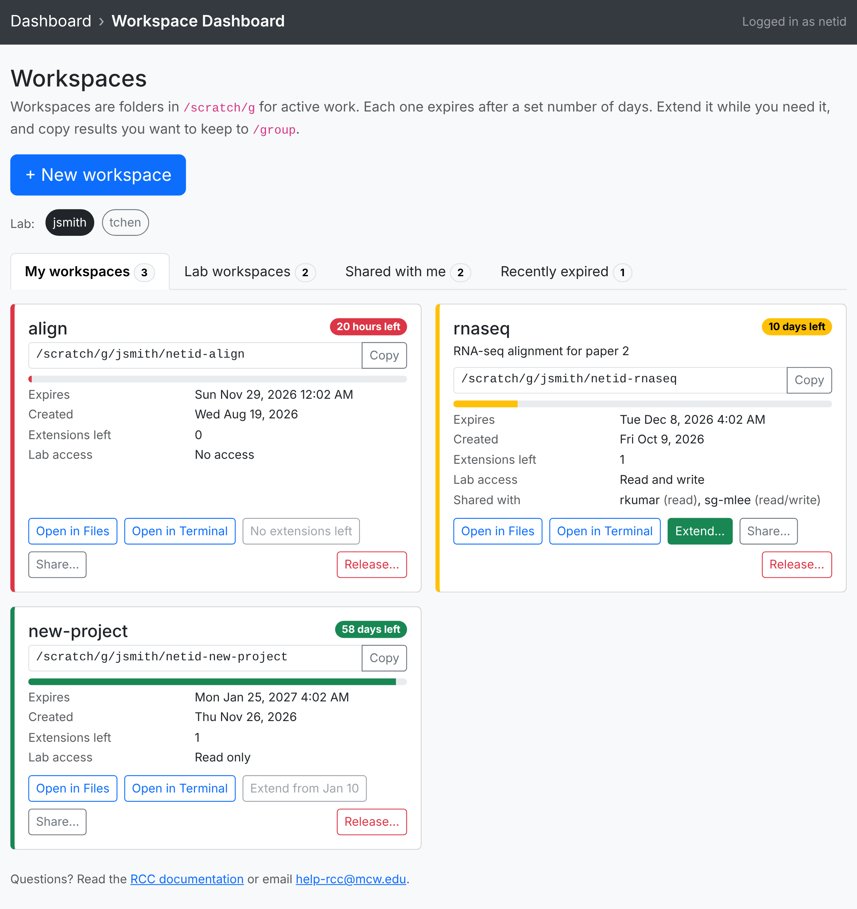
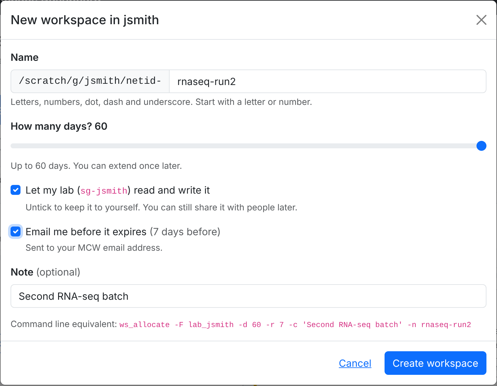
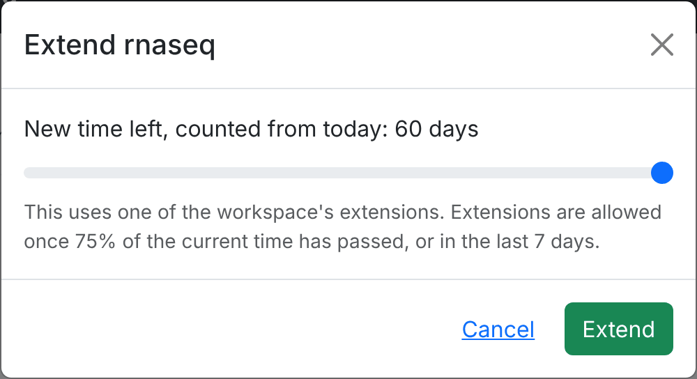
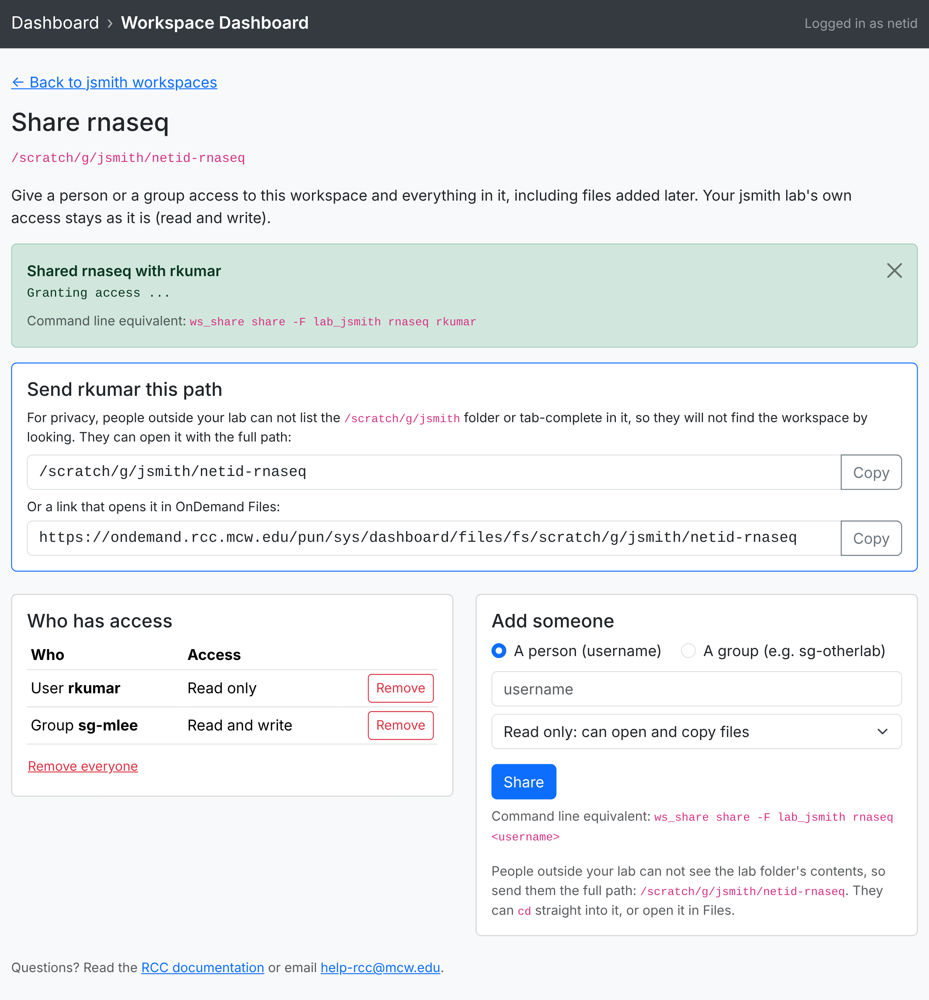
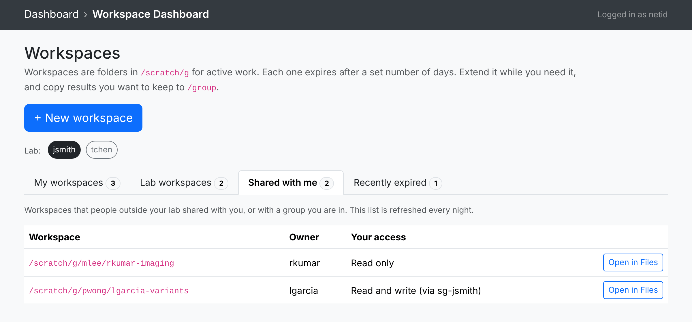
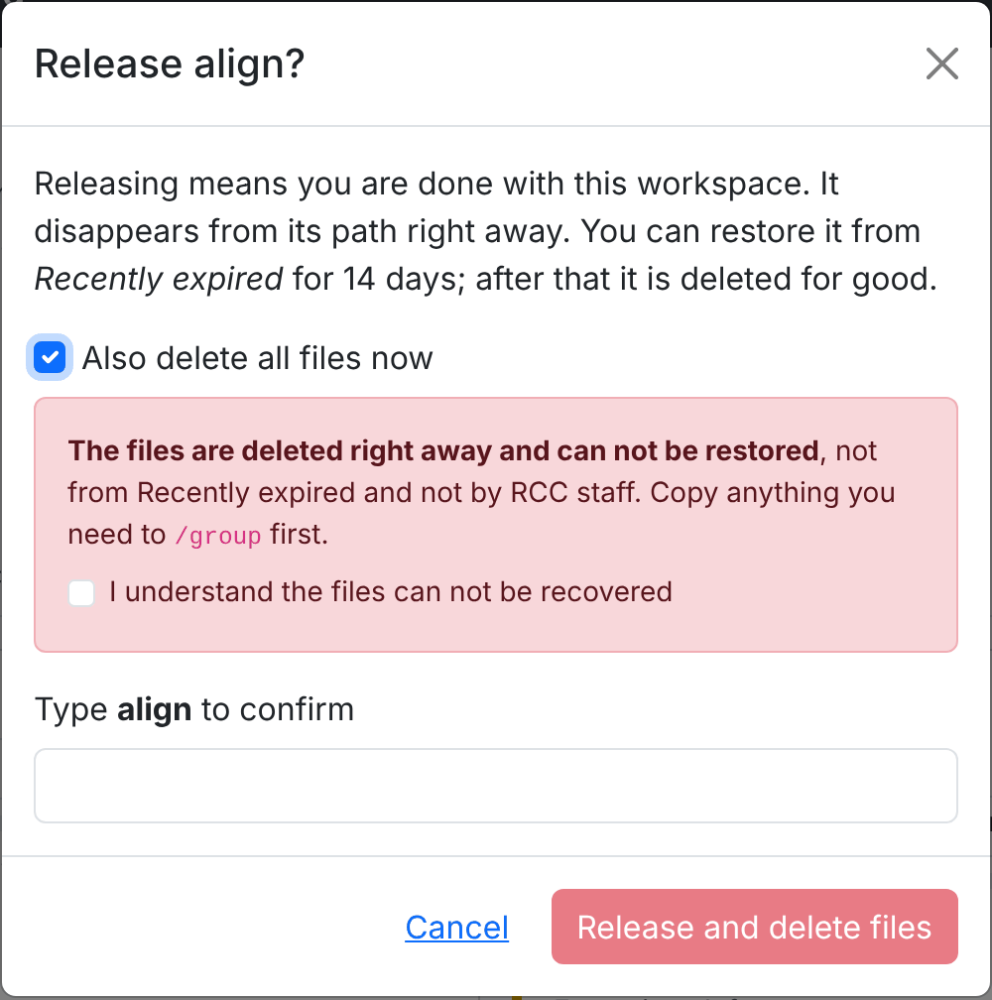
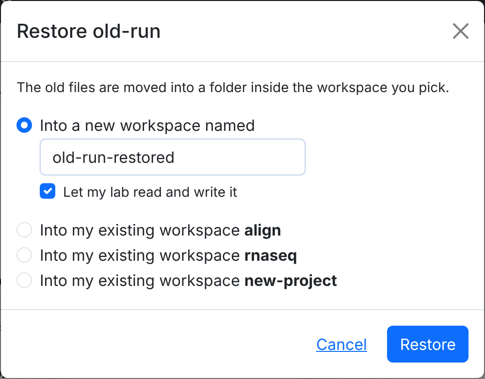

# Workspace Dashboard

The **Workspace Dashboard** is a page in [Open OnDemand](../cluster/access/ondemand.md) for managing your [scratch workspaces](workspaces.md) in your web browser. You can create, extend, share, release, and restore workspaces with a few clicks, with no command line needed.

The dashboard runs the same `ws_*` commands described in the [Scratch Workspaces](workspaces.md) guide, as you. The rules are the same, and so are the workspaces. A workspace you create in the dashboard shows up in `ws_list`, and one you create on the command line shows up in the dashboard.

!!! tip "Learn the command line as you go"
    After every action, the dashboard shows a **Command line equivalent**, such as `ws_share share -F lab_jsmith rnaseq rkumar`. The **New workspace** form updates its command as you fill it in. Copy these commands into your job scripts, or run them in a terminal next time.

## Open the Dashboard

1. Go to <https://ondemand.rcc.mcw.edu>{:target="_blank"} and log in with your MCW username and password.
2. In the top menu, select **Workspaces > Workspace Dashboard**. You can also click the **Workspace Dashboard** tile on the OnDemand front page.

If you belong to more than one lab, buttons with your labs' names appear above the tabs. Click a lab to switch to it. Everything on the page applies to the lab that is highlighted.

If your lab has not moved to workspaces yet, the dashboard says so. Keep using your lab's regular `/scratch/g/pi_netid` folder from the **Files** menu until RCC lets your lab know it is moving. A few labs keep a regular folder for good; the dashboard lists those as *Staying on a regular /scratch/g folder*.

## The Tabs

| Tab              | What it shows                                                                                                                  |
|------------------|--------------------------------------------------------------------------------------------------------------------------------|
| My workspaces    | Your own workspaces in this lab, with days left. The ones that expire first are at the top.                                    |
| Lab workspaces   | Workspaces of other members of your lab that you can see.                                                                      |
| Shared with me   | Workspaces that people outside your lab shared with you, or with a group you are in. See [Shared With Me](#shared-with-me).    |
| Recently expired | Your expired or released workspaces that you can still restore, and the last day you can. See [Restore](#restore-a-workspace). |

The number on each tab is how many items it has.

## Read a Workspace Card

Each workspace is shown as a card.

- **Days left** is the badge in the top right corner. It is green with more than 14 days left, yellow with 7 to 14 days, and red with less than 7 days. On the last day it counts hours instead, such as *3 hours left*. Hover over it to see the exact expiry time. The bar under the path shows how much of the workspace's time is left.
- **The path**, such as `/scratch/g/jsmith/netid-rnaseq`, is the folder to use in your job scripts. Click **Copy** to copy it.
- **Expires**, **Created**, and **Extensions left** come from `ws_list`.
- **Lab access** shows what your lab can do. *Read and write*, the default, means everyone in your lab can open, add, change, and delete files. *Read only* means your lab can open and copy files, but not change them. *No access* means the workspace is private to you and anyone listed under **Shared with**.
- **Shared with** lists the people and groups outside your lab that you shared it with, and whether each has *read* or *read/write* access. It is not shown when the workspace is not shared.

The buttons on the card:

| Button           | What it does                                                                                 |
|------------------|----------------------------------------------------------------------------------------------|
| Open in Files    | Opens the workspace in the OnDemand file browser, to upload, download, or view files.        |
| Open in Terminal | Opens a terminal in a new tab, already in the workspace folder.                              |
| Extend...        | Gives the workspace more time. See [Extend a Workspace](#extend-a-workspace).                |
| Share...         | Gives people or groups outside your lab access. See [Share a Workspace](#share-a-workspace). |
| Release...       | Tells RCC you are done with it. See [Release a Workspace](#release-a-workspace).             |

## Create a Workspace

1. Click **+ New workspace**.
2. Type a **Name**, such as `rnaseq-run2`. The full path is shown to the left of the box. Use letters, numbers, dots, dashes, and underscores.
3. Choose **How many days**, up to 60.
4. Leave **Let my lab read and write it** ticked to share it with your lab, which is the usual choice. Untick it to keep the workspace private. You can still share a private workspace with people later.
5. Optional: tick **Email me before it expires**. Starting the number of days shown next to the box (usually 7) before the workspace expires, you get a reminder at your MCW email address every night until it expires. RCC does not send reminders unless you tick this box.
6. Optional: add a **Note** to remind you what the workspace is for. It is shown on the card.
7. Click **Create workspace**.

!!! note "Set the reminder now"
    A reminder can only be added for free when you create a workspace. Adding one later uses the workspace's one extension. See [Get an Expiration Reminder](workspaces.md#get-an-expiration-reminder).

## Extend a Workspace

{{ ws_extend_rule }} See [When You Can Extend](workspaces.md#when-you-can-extend).

The **Extend** button on the card tells you where you stand:

- A green **Extend...** button means you can extend now.
- A grey **Extend from Jan 9** button means it is too early. Come back on that date. Hover over it to see why.
- A grey **No extensions left** button means the workspace was already extended. Copy what you need to [group storage](rcc-storage.md#group) before it expires, or create a new workspace.

To extend:

1. Click **Extend...** on the card.
2. Choose the new time left, counted from today. 60 days is the most.
3. Click **Extend**.

You can also extend a lab member's workspace from the **Lab workspaces** tab if they let the lab read and write it. This is useful when the owner is away and a shared workspace is about to expire.

The **Extend** form shows the command line equivalent, such as `ws_extend -F lab_jsmith rnaseq 30`. For a lab member's workspace it shows `ws_allocate -x ... -u <owner>` instead, because `ws_extend` cannot extend someone else's workspace.

## Share a Workspace

Your lab can already use your workspace, as shown under **Lab access**. Use **Share...** to give access to people or groups **outside your lab**. Only the owner of a workspace can share it.

!!! important "You can only share with RCC account holders"
    The person you share with must have an [RCC account](../cluster/accounts.md). An MCW username is not enough. If they do not have an account, the dashboard says `No RCC account named '...' was found`. Ask them to request an account first.

1. Click **Share...** on the workspace card.
2. Under **Add someone**, choose **A person** or **A group**.
3. Type their MCW username, such as `rkumar`, or a group name, such as `sg-mlee`.
4. Choose the access:
    - **Read only:** they can open, list, and copy your files.
    - **Read and write:** they can also add, change, and delete files.
5. Click **Share**.
6. Send them the path from the **Send this path** box. Click **Copy** next to the path, or next to the link that opens the workspace in OnDemand Files.

!!! warning "Always send the full path"
    People outside your lab cannot list your lab's `/scratch/g/pi_netid` folder, so they will not find your workspace by browsing. They need the exact path, such as `/scratch/g/jsmith/netid-rnaseq`. They can `cd` straight into it, or open it in Files.

### Share With Another Lab

To share with one person in another lab, choose **A person** and type their username.

To share with everyone in another lab, choose **A group** and type that lab's group name. A lab's group is `sg-` followed by the PI's MCW username. For example, Dr. Lee's lab is `sg-mlee`. Groups with more than 100 members cannot be used.

### Change or Remove Access

The **Who has access** list shows everyone you shared the workspace with, and whether they have *Read only* or *Read and write* access.

- **Change access:** share with the same person or group again and choose the other access. It replaces the old access.
- **Remove one:** click **Remove** next to the person or group.
- **Remove everyone:** click **Remove everyone**, check the list of who will lose access, and confirm. Your lab keeps its access.

Files you add later are shared automatically. Sharing ends when the workspace expires or is released.

!!! note "Files written by others count against your lab's quota"
    Files that people you shared with create in your workspace count against your lab's scratch quota. See [Share a Workspace](workspaces.md#share-a-workspace) for details.

### Shared With Me

The **Shared with me** tab lists workspaces that people outside your lab shared with you, or with a group you are in. It shows the owner and your access. Click **Open in Files** to open one.

The list is updated every 10 minutes, so a workspace shared with you shows up there within about 10 minutes. You do not have to wait: open the path the owner sent you in **Files**, or `cd` to it in a terminal.

## Release a Workspace

Release a workspace when you are done with it. This keeps scratch space free for your lab.

1. Click **Release...** on the card.
2. Type the workspace name to confirm.
3. Click **Release**.

The workspace disappears from its path right away. You can restore it from the **Recently expired** tab for 14 days. After that it is permanently deleted.

!!! danger "Also delete all files now"
    Ticking **Also delete all files now** deletes the files right away, to free up your lab's quota. They **cannot be restored**, not from **Recently expired** and not by RCC staff. You must also tick **I understand the files can not be recovered**. Copy anything you need to [group storage](rcc-storage.md#group) first.

## Restore a Workspace

A workspace that expired or was released can be restored for 14 days.

1. Open the **Recently expired** tab. The **Restorable until** column shows the last day and time you can restore each one. If two entries have the same name, the **Expired or released** time tells them apart.
2. Click **Restore...** next to the workspace.
3. Choose where to put the files:
    - **Into a new workspace named**: type a name. The dashboard creates the workspace for you.
    - **Into my existing workspace**: pick one of your workspaces.
4. Click **Restore**.

The files are put in a folder inside the workspace you chose. The folder has the old workspace's name with a number added, for example `/scratch/g/jsmith/netid-old-run-restored/netid-old-run-1795570887`. Move or copy the files from there.

On the command line, `ws_restore` asks a quick question to check you are a person. The dashboard answers it for you.

## Troubleshooting

| Message or problem                                            | What to do                                                                                                                    |
|---------------------------------------------------------------|-------------------------------------------------------------------------------------------------------------------------------|
| The **Workspaces** menu or tile is missing                    | Reload the OnDemand page. If it is still missing, log out of OnDemand and log back in.                                        |
| "None of your labs use workspaces yet"                        | Your lab has not moved to workspaces. Keep using `/scratch/g/pi_netid` from the **Files** menu.                               |
| A lab you just joined is missing, or "not currently a member" | Log out of OnDemand and log back in, so your new group membership is picked up.                                               |
| "This page had expired, so nothing was changed"               | The page was open for a long time. Nothing was changed. Try again.                                                            |
| "can not be extended yet"                                     | It is too early to extend. The card shows the first date you can. Your extension was not used.                                |
| "No RCC account named ... was found"                          | Check the spelling of the username. The person needs an [RCC account](../cluster/accounts.md) before you can share with them. |
| Someone you shared with cannot find the workspace             | Send them the full path from the card. They cannot browse your lab folder.                                                    |
| A workspace shared with you is not under Shared with me       | The list is updated every 10 minutes. Open the path the owner sent you in **Files** in the meantime.                          |
| Something else went wrong                                     | The red message box shows the error and the command line equivalent. Email <help-rcc@mcw.edu> with both.                      |

--8<-- "includes/abbreviations.md"
